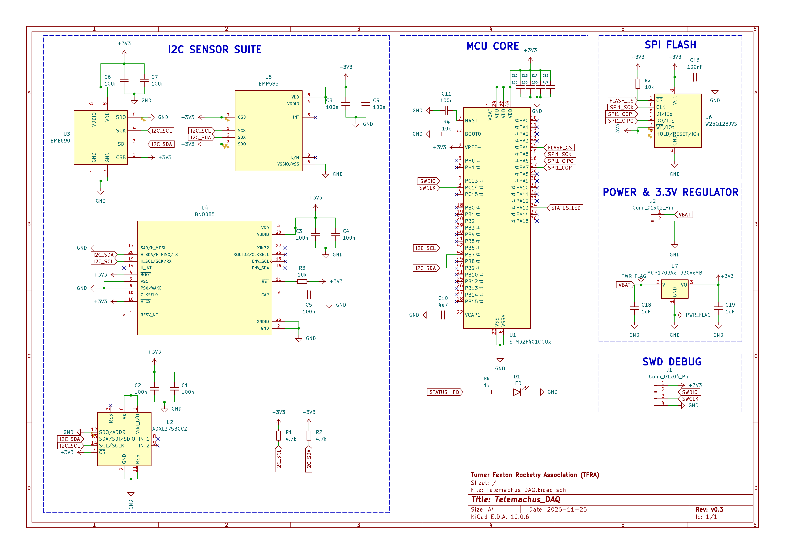

# Telemachus DAQ

Custom STM32F401-based flight data acquisition (DAQ) board designed in **KiCad 10** for **Turner Fenton Rocketry (TFRA)**. Built to record high-G acceleration, barometric altitude, 9-axis orientation, and environmental telemetry throughout powered ascent and recovery.

## Schematic Preview

## Hardware Overview

* **Microcontroller:** `STM32F401CCUx` (ARM Cortex-M4, 84 MHz, UFQFPN-48)
* **Bus Architecture:** Shared 3.3 V I2C bus (`PB6` = `I2C_SCL`, `PB9` = `I2C_SDA`) with external `4.7 kΩ` pull-up resistors (`R1`, `R2`)
* **Target Operating Voltage:** `3.3 V`

### Onboard Sensors & I2C Address Map

| Designator | Part Number | Sensor Type | I2C Address (7-bit) | Address Configuration |
| :--- | :--- | :--- | :--- | :--- |
| `U2` | **ADXL375BCCZ** | High-G 3-Axis Accelerometer (±200 g) | `0x53` | `SDO/ALT` tied to `GND`, `~CS` to `+3V3` |
| `U3` | **BME690** | Environmental Sensor (Gas, Temp, Humidity, Pressure) | `0x76` | `SDO` tied to `GND`, `CSB` to `+3V3` |
| `U4` | **BNO085** | 9-Axis Absolute Orientation IMU | `0x4A` | `SA0`/`PS0`/`PS1`/`CLKSEL0` to `GND`, `BOOT`/`H_CS` to `+3V3` |
| `U5` | **BMP585** | High-Precision Barometric Altimeter | `0x47` | `SDO` tied to `+3V3`, `CSB` to `+3V3` |

## Project Roadmap

| Version | Milestone | Status | Date Completed |
| :--- | :--- | :--- | :--- |
| **v0.1** | Initial block architecture and sensor selection | Done | 2026-11-15 |
| **v0.2** | Core MCU (`U1`) and bare sensor IC (`U2`–`U5`) schematic wiring, decoupling capacitors, and I2C address strapping | Done | 2026-11-19 |
| **v0.3** | Power supply regulation (`+3V3`), 4-pin SWD programming header, status LEDs, and onboard SPI flash logging | Done | 2026-11-25 |
| **v0.4** | PCB component placement, routing, and Design Rule Check (DRC) | Planned | — |
| **v1.0 (Rev A)** | PCB fabrication, assembly, and flight bring-up | Planned | — |

## Repository Structure

* `Components/` — Custom symbols, footprints, and 3D models imported for the project
* `telemachus_daq.kicad_pro` — KiCad project configuration and net classes
* `telemachus_daq.kicad_sch` — Main hardware schematic
* `telemachus_daq.kicad_pcb` — PCB layout file
* `.gitignore` — Excludes KiCad local UI state (`*.kicad_prl`), lock files, and `*-backups/` directories

## Credits & Component Libraries

* Schematic symbols, PCB footprints, and 3D models for select sensors and ICs were sourced from **[SnapMagic](https://www.snapmagic.com/)** (formerly SnapEDA).
* Built using **[KiCad EDA](https://www.kicad.org/)**.
